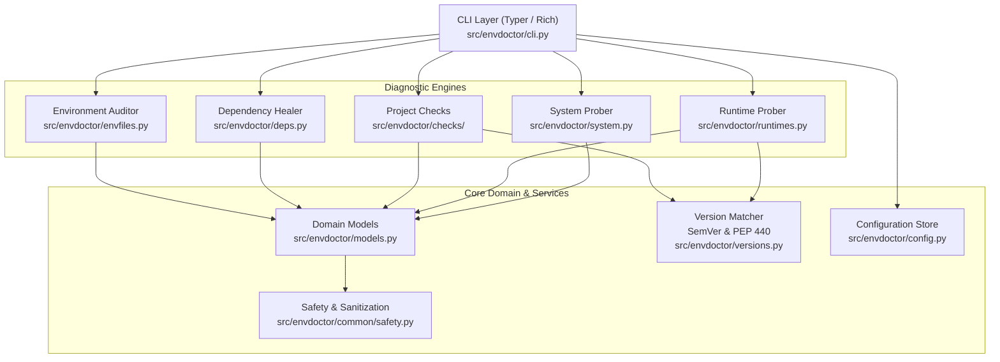

# Architecture Overview

`envdoctor` is designed as a modular, local-first diagnostics engine for software workstations and development repositories.

---

## High-Level Architecture

---

## Architectural Subsystems

### 1. CLI Presentation Layer (`src/envdoctor/cli.py`)
- Built using [Typer](https://typer.tiangolo.com/) and [Rich](https://rich.readthedocs.io/).
- Handles argument parsing, terminal formatting, exit code routing, and `--json` serialization.
- Ensures all outputs respect `--quiet`, `--verbose`, and `NO_COLOR` standards.

### 2. Diagnostic Engines

#### A. System Probing (`src/envdoctor/system.py`)
- Extracts host telemetry directly from the operating system:
  - macOS release info via `sw_vers` and Darwin kernel release.
  - Rosetta 2 translated execution state via `sysctl sysctl.proc_translated`.
  - CPU hardware brand, logical cores, and physical cores via `sysctl` and `os.cpu_count()`.
  - Memory statistics via `sysctl hw.memsize`.
  - APFS disk usage metrics via `os.statvfs()`.
  - PATH entry health (duplicate binaries, missing directory elements).

#### B. Runtime Probing (`src/envdoctor/runtimes.py`)
- Evaluates installed developer toolchains (Python, Node, npm, pnpm, yarn, Java, Git, Go, Rust, Ruby, PHP, Docker).
- **macOS Safety:** Prevents `/usr/bin/java` stub modal dialogs by verifying `/usr/libexec/java_home` before invocation.
- Validates Docker CLI presence and performs an isolated socket query to verify background daemon responsiveness.

#### C. Project Checks Engine (`src/envdoctor/checks/` & `detect.py`)
- Employs heuristic manifest detection to identify 14 project types.
- Dispatches isolated checks per ecosystem:
  - Dependency manifests (`package.json`, `Cargo.toml`, `go.mod`, `pom.xml`, `composer.json`, `pyproject.toml`).
  - Lockfile presence and synchronization.
  - Runtime constraint satisfaction using SemVer and PEP 440 engines.
  - Port conflict scanning against active local TCP listeners.

#### D. Dependency Healing (`src/envdoctor/deps.py`)
- Identifies missing installation directories (`node_modules`, `.venv`, `vendor/`).
- Proposes non-destructive, conservative installation commands (`npm install`, `composer install`, `python3 -m venv`).
- Never executes build tools automatically for ecosystems with arbitrary build hooks (e.g. Maven, Gradle).

#### E. Environment Variable Auditing (`src/envdoctor/envfiles.py`)
- Scans template files (`.env.example`, `.env.sample`, `docker-compose.yml`) and configuration requirements.
- Compares required variable names against `.env` and `os.environ`.
- Categorizes variables as `present`, `empty`, or `missing`.
- **Zero-Secret Model:** Secret values are never read, stored in data models, or serialized to logs.

---

## Core Domain & Infrastructure

### Version Matching Engine (`src/envdoctor/versions.py`)
- Implements SemVer 2.0 range parsing (caret `^`, tilde `~`, wildcards `*`, comparisons `>=`, `<=`, and unions `||`).
- Implements Python PEP 440 version specifiers (`~=`, `==`, `!=`, `>=`, `<`).
- Guarantees conservative evaluation: unparseable or complex constraints return clean status without crashing.

### Domain Models (`src/envdoctor/models.py`)
- Strongly typed dataclasses representing `CheckResult`, `SystemInfo`, `RuntimeInfo`, `EnvReport`, `DepsReport`, and `FullReport`.
- Automated redaction hooks sanitize all diagnostic text fields upon initialization.

### Safety & Defense Layer (`src/envdoctor/common/safety.py`)
- Pattern-based redaction of API keys, bearer tokens, passwords, private keys, and authorization headers.
- Safe subprocess execution wrappers enforcing `shell=False`, argument list validation, and execution timeouts.

### Configuration Management (`src/envdoctor/config.py`)
- Typed configuration schema stored in standard OS directories via `platformdirs`.
- Supports runtime overrides via the `DEVTOOLKIT_HOME` environment variable.
